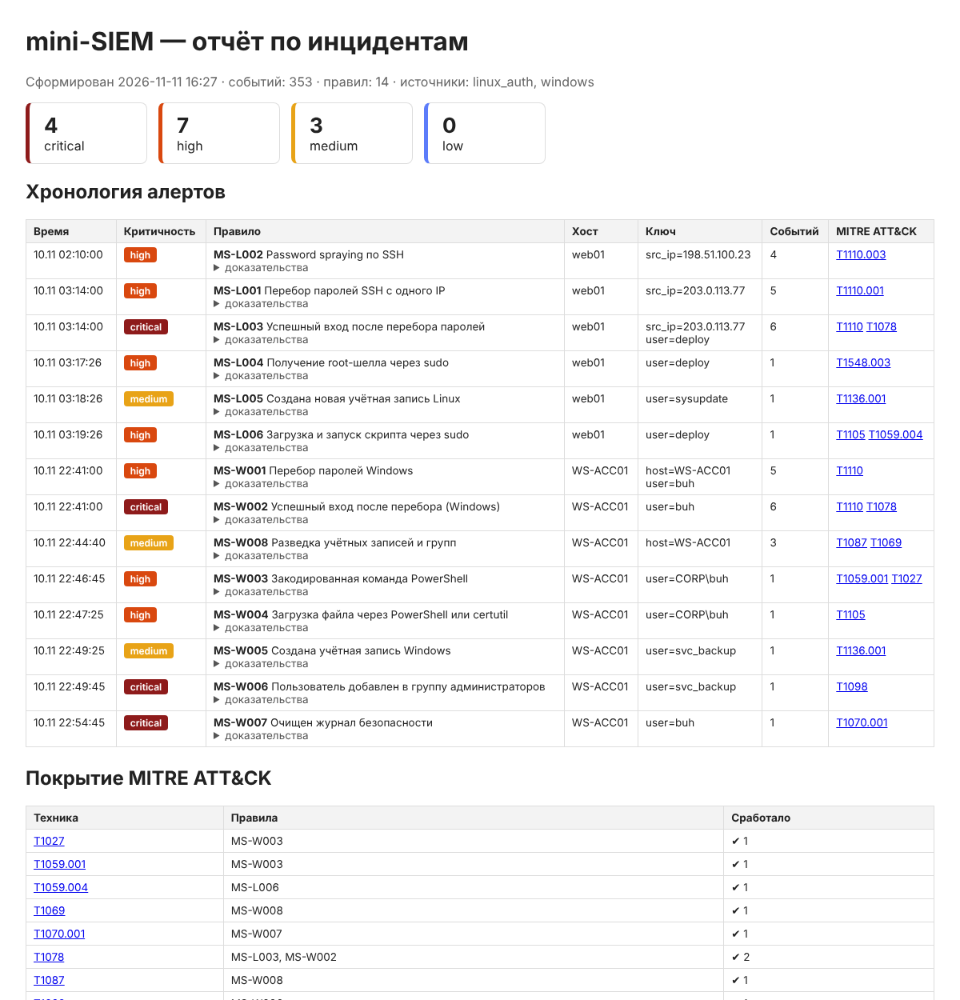

# mini-SIEM — корреляция событий безопасности Linux и Windows

Лёгкий движок корреляции на Python: разбирает `auth.log` и события Windows (Security + Sysmon), прогоняет их через YAML-правила с привязкой к MITRE ATT&CK и строит отчёт по инцидентам. На демонстрационных журналах (353 события) восстанавливает **обе цепочки атаки — 14 алертов из 14 правил, без ложных срабатываний на фоновой активности**.



## Зачем

В Wazuh-стенде ([соседний проект](https://github.com/MrNoisyBoy)) я пользовался готовым движком. Здесь я написал движок сам, чтобы разобраться, как SIEM устроен внутри: нормализация событий, пороговые правила со скользящим окном, подавление дублей, корреляция последовательностей.

## Возможности

- **Парсеры:** Linux `auth.log`/`secure` (sshd, sudo, useradd) и Windows JSON Lines (4624, 4625, 4688, 4720, 4732, 1102, Sysmon 1) → единая схема события.
- **Три типа правил:**
  - `match` — одно событие (например, очистка журнала);
  - `threshold` — N событий или N **разных** значений поля за окно, с группировкой (перебор, password spraying);
  - `sequence` — событие после алерта другого правила по общему ключу (успешный вход после перебора).
- **Условия в стиле Sigma:** `field`, `|contains`, `|startswith`, `|endswith`, `|re`, `|in`, `exclude`.
- Подавление повторных алертов по одной атаке в пределах окна.
- Вывод: консоль, `alerts.jsonl` (для отправки дальше), HTML-отчёт с хронологией, доказательствами и картой покрытия ATT&CK.

## Правила

| ID | Правило | Тип | Критичность | ATT&CK |
| --- | --- | --- | --- | --- |
| MS-L001 | Перебор паролей SSH с одного IP | threshold | high | T1110.001 |
| MS-L002 | Password spraying по SSH | threshold (distinct) | high | T1110.003 |
| MS-L003 | Успешный вход после перебора | sequence | critical | T1110, T1078 |
| MS-L004 | Root-шелл через sudo | match | high | T1548.003 |
| MS-L005 | Новая учётная запись Linux | match | medium | T1136.001 |
| MS-L006 | `curl \| bash` / запуск из /tmp через sudo | match | high | T1105, T1059.004 |
| MS-W001 | Перебор паролей Windows (4625) | threshold | high | T1110 |
| MS-W002 | Успешный вход после перебора (4624) | sequence | critical | T1110, T1078 |
| MS-W003 | PowerShell `-EncodedCommand` | match | high | T1059.001, T1027 |
| MS-W004 | Download cradle / certutil | match | high | T1105 |
| MS-W005 | Новая учётная запись Windows (4720) | match | medium | T1136.001 |
| MS-W006 | Добавление в Administrators (4732) | match | critical | T1098 |
| MS-W007 | Очистка журнала (1102) | match | critical | T1070.001 |
| MS-W008 | Разведка: whoami, net user/group, nltest | threshold | medium | T1087, T1069 |

Пример правила:

```yaml
id: MS-L002
title: Password spraying по SSH
severity: high
type: threshold
mitre: [T1110.003]
condition:
  source: linux_auth
  event_type: logon_failure
threshold:
  group_by: [src_ip]
  count: 4
  distinct: user      # считаем разные логины, а не попытки
  window: 10m
```

## Запуск

```bash
pip install -r requirements.txt
python -m minisiem.samples                       # демо-журналы в samples/
python -m minisiem.cli samples/auth.log samples/windows_events.jsonl --year 2026
python -m pytest -q                              # 20 тестов
```

Свои журналы:

```bash
sudo cp /var/log/auth.log . && python -m minisiem.cli auth.log --min-severity high
```

Выгрузка событий Windows в нужном формате (PowerShell):

```powershell
Get-WinEvent -FilterHashtable @{LogName='Security'; Id=4624,4625,4720,4732,1102} -MaxEvents 5000 |
  ForEach-Object { $x=[xml]$_.ToXml(); $d=@{TimeCreated=$_.TimeCreated.ToUniversalTime().ToString('o');
  EventID=$_.Id; Computer=$_.MachineName; Provider=$_.ProviderName}
  $x.Event.EventData.Data | ForEach-Object { $d[$_.Name]=$_.'#text' }; $d | ConvertTo-Json -Compress } |
  Out-File -Encoding utf8 windows_events.jsonl
```

## Демо-сценарий

Журналы генерирует `minisiem/samples.py`: около 300 фоновых событий (входы сотрудников, опечатки в паролях, рутинный sudo, запуск 1С и Office) и две атаки. Используются только адреса из документационных диапазонов RFC 5737.

1. **web01:** password spraying → перебор пароля `deploy` → успешный вход → `sudo bash` → пользователь-бэкдор → `curl | bash`.
2. **WS-ACC01 (бухгалтерия):** перебор RDP-пароля → вход → разведка → PowerShell `-enc` → certutil-загрузка → новый администратор → очистка журнала.

## Тесты

Покрыты парсеры, все модификаторы условий, экранирование отчёта, окно и группировка пороговых правил, корреляция последовательностей. Сквозные тесты проверяют, что на атаке срабатывает каждое правило, а на чистом фоне — ни одно.

## Безопасность самого инструмента

Строки журналов может контролировать атакующий (например, имя пользователя в попытке входа), поэтому всё содержимое событий экранируется в HTML-отчёте. Защита от XSS покрыта тестом.

## Стек

Python 3.11+, PyYAML, Jinja2, pytest

## Что можно добавить

- Чтение `.evtx` напрямую (python-evtx) и приём syslog по сети.
- Конвертер Sigma → формат правил mini-SIEM.
- Обогащение IP по GeoIP и спискам репутации.
